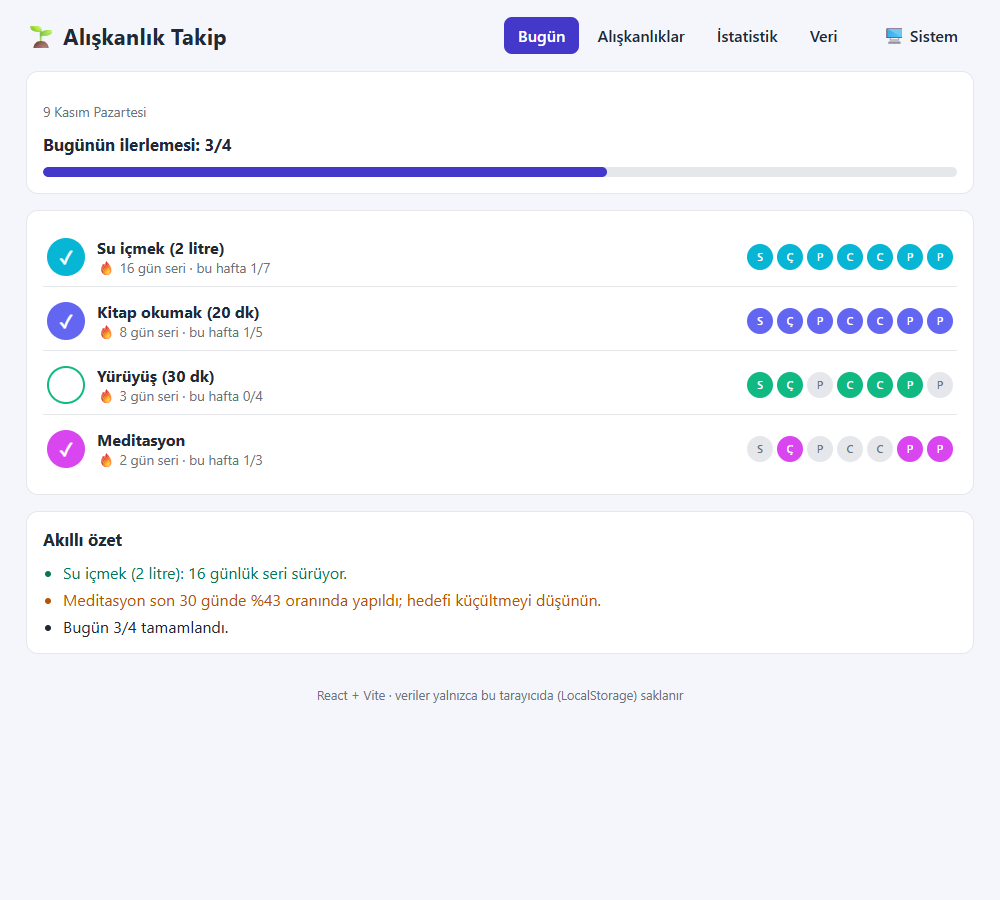
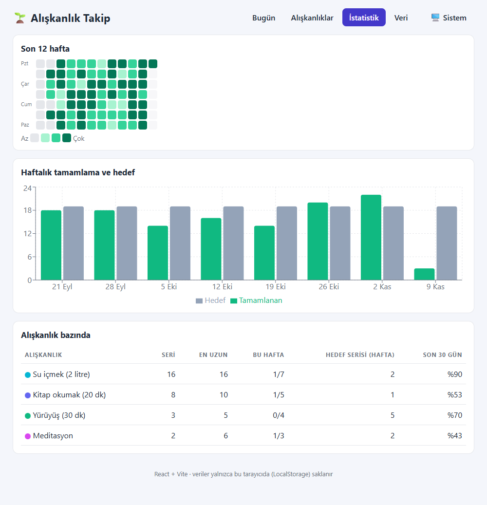
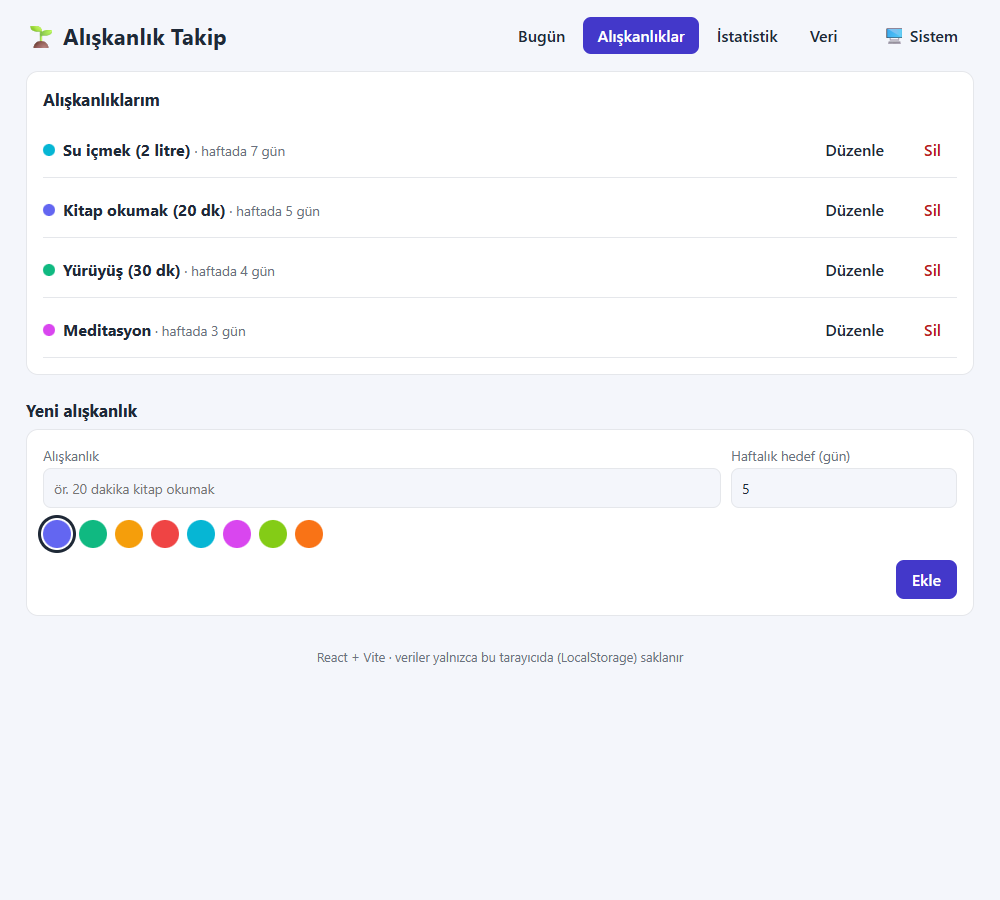
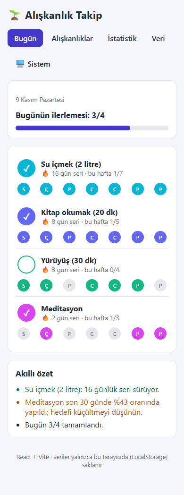
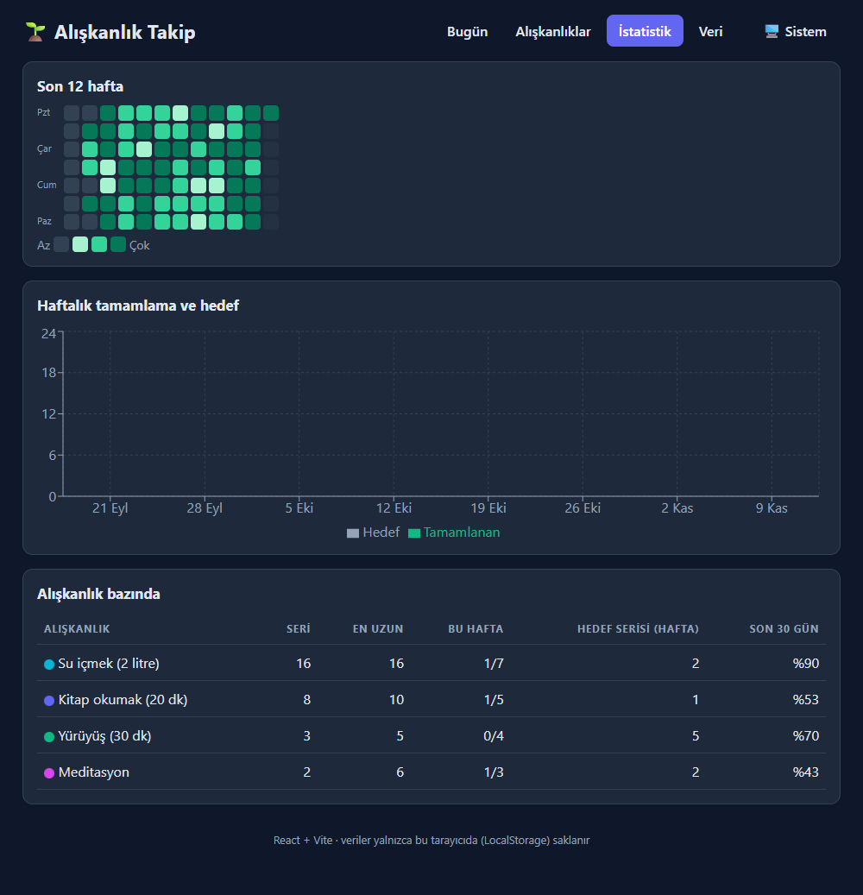

# 🌱 Alışkanlık Takip

React (Vite) ile yazılmış çok sayfalı alışkanlık takip uygulaması: günlük işaretleme, seriler (streak), haftalık hedefler, ısı haritası, istatistikler ve kural tabanlı akıllı özet. Sunucu veya hesap gerekmez; veriler **LocalStorage**'da saklanır.



**Canlı bağlantı:** https://b4tukk.github.io/aliskanlik-takip-react/ _(GitHub Actions ile otomatik yayınlanır)_

## Özellikler
- **Bugün:** alışkanlıkları tek dokunuşla işaretleme, son 7 günlük şeritten geçmiş günleri düzeltme, günlük ilerleme çubuğu, seri rozetleri
- **Alışkanlıklar:** ekleme, düzenleme, renk seçimi, haftalık hedef (1–7 gün), silme + **geri al**
- **İstatistik:** son 12 haftanın ısı haritası, haftalık tamamlama/hedef grafiği, alışkanlık bazında seri, en uzun seri, hedef serisi (üst üste hedefi tutturulan hafta) ve son 30 gün oranı
- **Akıllı özet:** kural tabanlı cümleler (ör. "Su içmek: 16 günlük seri sürüyor", "bu hafta hedefe yetişmek için kalan gün yetmiyor")
- **Veri:** CSV/JSON dışa-içe aktarma (satır bazlı hata raporu, aynı adlı alışkanlıkları birleştirme), örnek veri, tümünü silme
- Koyu/açık/sistem teması, mobil uyum, erişilebilirlik (aria etiketleri, odak halkası, klavye)

## Hesaplama kuralları
- **Seri:** bugünden geriye ardışık günler; bugün henüz işaretlenmediyse seri dünden sayılır, yani gün bitmeden seri bozulmaz.
- **Hedef serisi:** haftalık hedefi (Pzt–Paz) tutturan ardışık hafta; içinde bulunulan hafta henüz bitmediyse yalnızca tutturulmuşsa sayılır.
- **Oran:** alışkanlığın oluşturulduğu günden önceki günler paydaya girmez.
- Tarihler UTC üzerinden hesaplanır; yaz saati geçişi gün sayımını bozmaz.

## Teknolojiler
React 19, Vite, React Router (HashRouter), Recharts, `useReducer` + Context, saf CSS, Vitest + Testing Library, Oxlint, GitHub Actions (CI + Pages)

## Kurulum
```bash
npm install
npm run dev       # geliştirme
npm test          # 42 test
npm run lint
npm run build     # dist/
```

## Mimari
```
src/
  lib/        dates (UTC tarih), stats (seri, oran, ısı haritası, özet), validate, csv, sample
  store/      reducer, storage (doğrulayıcı sanitize), StoreContext
  components/ Layout, HabitForm, HabitRow, Heatmap
  pages/      Today, Habits, Stats, DataPage
  test/       lib.test.js (birim: tarih/seri/oran/reducer/storage/csv), app.test.jsx (kullanıcı akışları)
```

## Yapay zekanın kullanımı
Geliştirmede yapay zeka asistanı olarak **Claude (Claude Code)** kullanıldı.

| Aşama | Yapay zekadan alınan yardım |
|---|---|
| Fikir ve planlama | Uygulama fikri, ekranlar ve veri modeli (`habits`, `logs[id][tarih]`), seri kurallarının tanımı |
| Geliştirme | Reducer, seri/oran hesapları, bileşen ve CSS taslakları |
| Doğrulama | Seri ve tarih sınır durumları için birim testleri, kullanıcı akışı testleri; Edge ile gerçek tarayıcıda gezinme, mobil taşma ve konsol hatası kontrolü |
| Dokümantasyon | Bu README'nin taslağı |

Üretilen kodun anlaşılması ve gözden geçirilmesi geliştiricinin sorumluluğundadır.

## Ekran görüntüleri
| İstatistik | Alışkanlıklar | Mobil | Koyu tema |
|---|---|---|---|
|  |  |  |  |

## Sınırlar
Veriler yalnızca tarayıcıdadır (cihazlar arası senkron yok); hatırlatıcı/bildirim yok; haftanın ilk günü Pazartesi sabittir.
